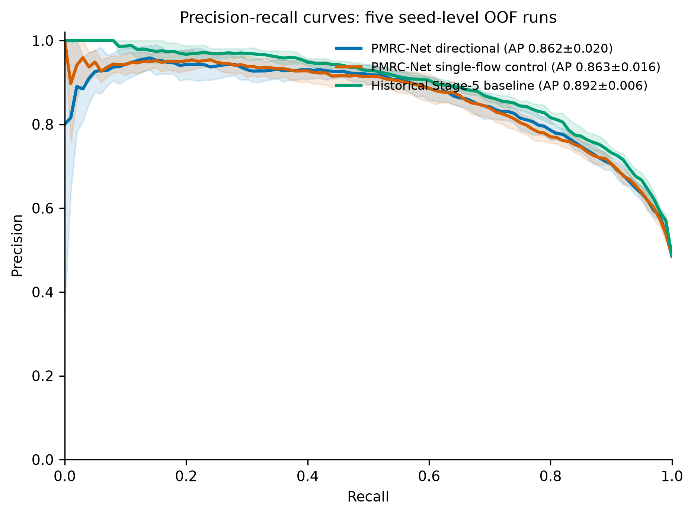
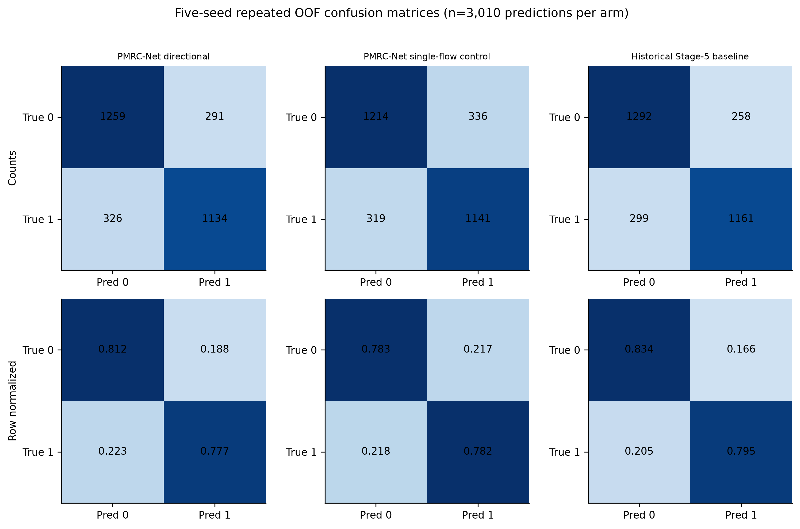
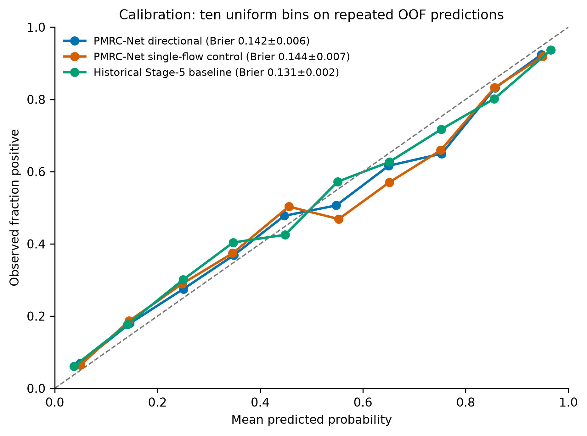
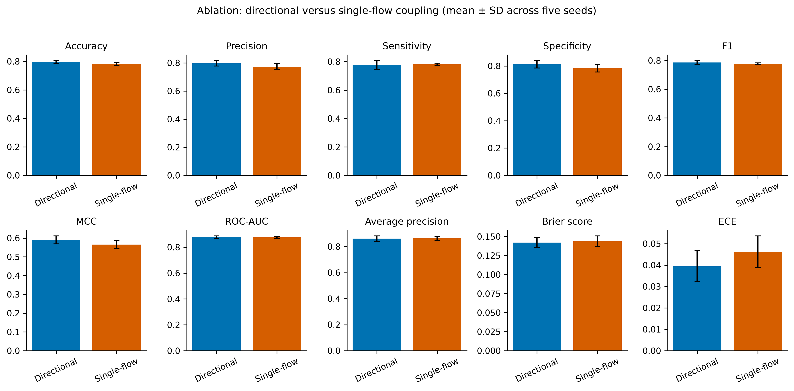
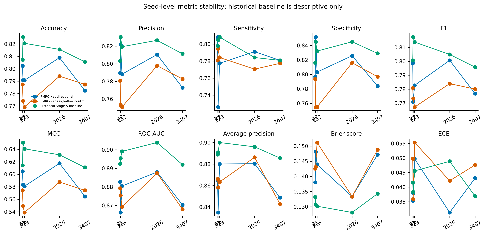

# PMRC-Net for Tabular Heart-Disease Classification: An Exploratory Five-Seed Nested-CV Evaluation

[Author names and affiliations to be completed]

## Abstract

Background: Small tabular heart-disease datasets invite overfitting, and named physiological or pathway components do not by themselves establish clinical validity. Methods: We evaluated the existing improved PMRC-Net using five-seed, five-fold outer and four-fold inner nested cross-validation on 602 exact-deduplicated rows from a merged 13-feature CSV. Inner folds alone selected hyperparameters, temperature, and decision thresholds. A directional-coupling arm was compared with a single-flow coupling control. Results: Mean seed-level ROC-AUC was 0.8776 for the directional arm and 0.8759 for the control (paired exact Wilcoxon p=0.4375, five seed pairs); corresponding accuracy was 0.7950 and 0.7824. The historical Stage-5 baseline had ROC-AUC 0.8966, but its outer validation fold was used for checkpoint/epoch selection, so this is not an unbiased or controlled comparator. Conclusion: The observed directional-versus-single-flow difference is small and uncertain. The experiment does not establish clinical utility, external generalization, or superiority to the historical baseline.

**Keywords:** tabular learning; nested cross-validation; calibration; heart-disease classification; reproducibility; model selection

## 1 Introduction

Clinical prediction with structured data requires more than a high discrimination score: data provenance, validation design, calibration, and deployment context all matter. Published cardiovascular and electronic-health-record studies illustrate the potential of machine learning, while also operating on populations and data regimes unlike the small merged CSV evaluated here [15] [7]. Reporting guidance emphasizes transparent description of data, model development, and validation [11].

Deep learning for tabular data remains sensitive to dataset size, inductive bias, and comparison protocol. Prior work includes attentive feature selection and systematic tabular benchmarks, but does not imply that a custom neural architecture is superior on a particular small dataset [1] [4] [5]. This study therefore asks a narrow engineering question: under a nested protocol, does the direction-specific interaction flow in the existing improved PMRC-Net produce different seed-level results from its legacy single-flow control?

The work is exploratory. The feature-group names and physiology-derived scalar are design choices, not validated biological pathways or causal explanations. The dataset has no verified patient identifier or external cohort. No clinical-use claim is made.

**Table 01. Dataset and preprocessing audit**

| Characteristic | Value | Notes |
| --- | --- | --- |
| Raw rows | 1,888 | Merged CSV; provenance and patient identifiers unavailable |
| Exact duplicate rows removed | 1,286 | Exact-row deduplication only |
| Rows after deduplication | 602 | No claim of unique patients |
| Predictors | 13 (5 continuous, 8 categorical) | Target excluded |
| Raw target counts | 0: 911; 1: 977 | Target coding retained as stored |
| Deduplicated target counts | 0: 310; 1: 292 | 602 total rows |
| Missing cells | 0 | No missing values in the source CSV |
| ca = 4 | 28 raw; 5 after deduplication | Loader preserves category 4; it is not imputed or mapped to missing |
| Dataset SHA-256 | a786b4a0...7ad42b90 | Full hash is recorded in run_config.json and the repository audit |

## 2 Related Work

Tabular neural architectures such as TabNet and benchmark-oriented studies motivate explicit comparison rather than assuming neural models dominate tree-based or simpler alternatives [1] [4] [5]. We do not claim a new architecture class or state-of-the-art result; the tested contrast is a directional interaction implementation against a single-flow control.

Nested model selection is needed because repeatedly using validation data to choose hyperparameters or stopping epochs biases performance estimates [2] [12]. Small samples also produce substantial uncertainty even when cross-validation is repeated [13]. Calibration is a separate property from ranking discrimination; temperature scaling and calibration assessment have been studied in neural and clinical prediction settings [6] [14].

For a binary task, ROC-AUC is complemented by precision-recall summaries, thresholded measures, and proper scoring/calibration metrics [9]. The age-predicted maximal-heart-rate equation used by the engineered mismatch follows a population-level relationship, not an individualized physiologic measurement [10]. Named inputs or pathway branches do not alone establish interpretability; high-stakes interpretability requires stronger evidence and careful framing [8].

## 3 Methods

3.1 Dataset and preprocessing. The exact source is dataset/cleaned_merged_heart_dataset.csv (SHA-256 recorded in the configuration). It contains 1,888 rows and 14 columns before exact-row deduplication; 1,286 repeated rows are removed, leaving 602 rows with 13 predictors and one binary target. The deduplicated target counts are 310 class-0 and 292 class-1 rows. There are no missing cells in the CSV. The provenance and unit of observation are unknown; exact deduplication does not establish unique patients. Five continuous features are standardized from each training partition only; eight categorical columns use fixed project mappings. In particular, ca=4 is retained as a category (five deduplicated rows), not interpreted as missing or imputed.

3.2 Architecture. The implementation uses three named encoders over a partition of the 13 predictors: metabolic (age, sex, trestbps, chol, fbs), exercise (thalachh, oldpeak, exang, slope), and coronary (cp, restecg, ca, thal). Each pathway is projected to a 16-dimensional representation with the implementation's activation, dropout, and normalization layers. The physiology branch uses age, maximum heart rate (thalachh), oldpeak, and exang to construct a mismatch scalar:

$$
\begin{aligned}M &= \max\left(1 - \frac{\mathrm{thalachh}}{\max(208 - 0.7\,\mathrm{age},1)},0\right)\\&\quad \cdot \mathrm{softplus}\bigl(a_1\mathrm{oldpeak} + a_2\mathrm{exang}\\&\qquad + a_3\mathrm{oldpeak}\,\mathrm{exang}\bigr)\end{aligned}
$$

where each learned coefficient is constrained to be nonnegative. This deterministic engineered score is a modeling feature, not a clinical physiologic measurement. Each pair of pathway representations forms forward and reversed transformed products, combined with learned sigmoid gates. The directional arm uses separate transforms for the reversed ordering; the control uses a single forward flow and is not a symmetric-coupling model. Three scalar logits (mechanistic, interaction, residual) are added to form the final logit.

*Figure 1. Model schematic from implementation: three named feature-group encoders, a physiology-mismatch projection, pairwise gated interactions, and additive mechanistic, interaction, and residual logits. The labels describe the engineered architecture, not validated biological pathways or causal mechanisms.*

3.3 Training objective. Training combines binary cross entropy with the code's association-conditioned physiology hinge, coupling/gate/residual regularization, and AdamW weight decay. The configured l1_lambda is not consumed by the implemented objective. The empirical association of ca is calculated but does not contribute to the hinge. In 100 inner-training partitions, positive association signs occurred for oldpeak in 4 and exang in 9; in all 25 outer-refit partitions both signs were negative. Thus, the feature-specific physiology hinge for these variables was inactive in the outer refits, limiting any claim that the final fits demonstrate benefit from that regularizer.

3.4 Nested evaluation. Five seeds (21, 42, 123, 2026, 3407) each define five stratified outer folds. Each outer-training partition is split into four inner folds using the recorded seed-plus-fold offset. Three configured candidates are compared by mean inner ROC-AUC plus 0.5 times MCC; epoch selection uses inner validation loss. The selected candidate's inner out-of-fold predictions alone determine scalar temperature and Youden-J threshold. The selected configuration is refit on the complete outer-training partition, and the outer test fold is evaluated once. The process is repeated for both nested arms. The saved OOF files contain 602 predictions per seed and arm.

*Figure 2. Nested evaluation protocol for each of five seeds and two trainable arms. Inner folds are confined to the outer training partition for candidate selection, temperature scaling, and Youden-threshold selection; each outer test fold is evaluated once.*

3.5 Metrics and statistical analysis. We report accuracy, precision, sensitivity, specificity, F1, MCC, ROC-AUC, average precision, Brier score, and 10-bin expected calibration error (ECE). Seed-level summaries use mean and sample standard deviation over five seeds. Exact two-sided Wilcoxon signed-rank tests use the five paired seed-level values for each metric; p-values are exploratory, unadjusted, and not patient-level uncertainty estimates because the seeds reuse the same dataset and overlapping folds.

**Table 02. Nested-CV protocol, hardware, and software**

| Setting | Value |
| --- | --- |
| Outer/inner CV | 5 outer folds; 4 inner folds |
| Seeds | 21, 42, 123, 2026, 3407 |
| Batch size / precision | 16 / FP32 |
| Device | NVIDIA GeForce RTX 2050 (4096 MiB); CUDA 12.8 |
| CPU / data workers | 2 threads; 1 inter-op; 0 workers |
| Optimizer | AdamW; fold-local standardization; max epochs 30; patience 8; gradient clip 1.0 |
| Candidate grid | 3 candidates; see supplementary/run_config.json |
| Selection score | mean inner-fold ROC-AUC + 0.5 * MCC |
| Calibration and threshold | Scalar temperature and Youden J threshold from selected-candidate inner OOF only |
| Outer evaluation | One evaluation per outer test fold; 25 outer folds per arm |
| Measured wall time | 2.45 h (8831.9 s) |
| Max system RAM | 91.3% (1696 MiB peak process RSS) |
| GPU temperature / utilization | 60 °C maximum; 78% max utilization |
| Runtime versions | Python 3.11.9; PyTorch 2.11.0+cu128; CUDA 12.8; NumPy 2.4.6; pandas 2.3.3; scikit-learn 1.9.1; SciPy 1.17.1; Matplotlib 3.11.2; NetworkX 3.6.1; PyYAML 6.0.3 |

## 4 Results

The full run completed all 50 arm/fold checkpoints with no skipped fold. Each nested arm produced 25 fold records and 3,010 OOF prediction records across five seeds. The recorded wall time was 2.45 hours; maximum system RAM was 91.3 percent, maximum GPU temperature 60 degrees C, and no CUDA OOM or fold failure was recorded.

4.1 Main metrics. The directional arm achieved mean ROC-AUC 0.8776 (SD 0.0090), average precision 0.8618 (SD 0.0199), accuracy 0.7950, Brier score 0.1421, and ECE 0.0395. The single-flow control achieved ROC-AUC 0.8759 (SD 0.0079), average precision 0.8633, accuracy 0.7824, Brier score 0.1438, and ECE 0.0462.

**Table 03. Five-seed out-of-fold metrics**

| Metric | PMRC-Net directional | PMRC-Net single-flow control | Historical Stage-5 baseline |
| --- | --- | --- | --- |
| Accuracy | 0.7950 ± 0.0105 | 0.7824 ± 0.0104 | 0.8150 ± 0.0085 |
| Precision | 0.7965 ± 0.0194 | 0.7731 ± 0.0204 | 0.8183 ± 0.0110 |
| Sensitivity | 0.7767 ± 0.0308 | 0.7815 ± 0.0089 | 0.7952 ± 0.0122 |
| Specificity | 0.8123 ± 0.0267 | 0.7832 ± 0.0273 | 0.8335 ± 0.0122 |
| F1 | 0.7860 ± 0.0132 | 0.7771 ± 0.0068 | 0.8065 ± 0.0090 |
| MCC | 0.5902 ± 0.0209 | 0.5649 ± 0.0201 | 0.6296 ± 0.0171 |
| ROC-AUC | 0.8776 ± 0.0090 | 0.8759 ± 0.0079 | 0.8966 ± 0.0050 |
| Average precision | 0.8618 ± 0.0199 | 0.8633 ± 0.0157 | 0.8923 ± 0.0058 |
| Brier score | 0.1421 ± 0.0063 | 0.1438 ± 0.0069 | 0.1313 ± 0.0025 |
| ECE | 0.0395 ± 0.0072 | 0.0462 ± 0.0074 | 0.0423 ± 0.0050 |

4.2 Coupling ablation. The mean paired ROC-AUC difference (directional minus single-flow) was +0.0017, with exact paired p=0.4375 across five seed pairs. The corresponding mean accuracy difference was +0.0126. No paired metric had p < 0.05; the small number of repeated seeds, shared observations, and uncorrected multiple metrics make these results exploratory rather than confirmatory.

**Table 04. Exploratory paired-seed differences; n = 5 seed pairs**

| Metric | Directional - single-flow | Exact paired p | Direction |
| --- | --- | --- | --- |
| Accuracy | +0.0126 | 0.1250 | Higher is better |
| Precision | +0.0234 | 0.1875 | Higher is better |
| Sensitivity | -0.0048 | 1.0000 | Higher is better |
| Specificity | +0.0290 | 0.3125 | Higher is better |
| F1 | +0.0089 | 0.3125 | Higher is better |
| MCC | +0.0253 | 0.1250 | Higher is better |
| ROC-AUC | +0.0017 | 0.4375 | Higher is better |
| Average precision | -0.0015 | 1.0000 | Higher is better |
| Brier score | -0.0017 | 0.4375 | Lower is better |
| ECE | -0.0067 | 0.1250 | Lower is better |

*Figure 3. Seed-averaged ROC curves with between-seed standard-deviation bands. Each seed contributes one out-of-fold prediction per observation. The Stage-5 baseline is shown only as historical context because it selected epochs using its outer validation fold.*

*Figure 4. Seed-averaged precision-recall curves with between-seed standard-deviation bands. Average precision is reported; the historical baseline is protocol-mismatched and is not a controlled comparator.*

*Figure 5. Confusion matrices aggregated over five repeated OOF runs (3,010 predictions per arm). Cells are repeated predictions on the same 602 deduplicated rows, not independent patients.*

*Figure 6. Reliability diagrams using ten equal-width bins on the five-seed OOF predictions. Brier score and expected calibration error are summarized across seeds; repeated predictions must not be interpreted as independent observations.*

*Figure 7. Exploratory paired-seed comparison of directional and single-flow coupling controls. Error bars show standard deviation across five seeds; no metric shows a statistically significant paired difference at 0.05.*

*Figure 8. Per-seed metric stability for both nested arms and the historical Stage-5 baseline. Baseline traces are descriptive only because its outer validation fold influenced checkpoint selection.*

4.3 Historical baseline. The Stage-5 historical OOF baseline had mean ROC-AUC 0.8966 (SD 0.0050); this value is not a valid unbiased estimate for controlled comparison. Stage 5 selects its checkpoint/epoch using the same fold-specific validation loader later treated as the nominal OOF test fold. The baseline also uses the original architecture, a fixed 0.5 threshold, and no inner-only calibration. Its metrics and nominal paired tests are retained only for traceability and historical context; no comparative inference is drawn.

**Table 05. Paired-seed statistical analysis; baseline p-value is invalid as controlled inference**

| Comparison | Metric | Pairs | Two-sided p | Interpretation / limitation |
| --- | --- | --- | --- | --- |
| Directional vs single-flow | Accuracy | 5 | 0.1250 | Exploratory; no correction for multiple metrics |
| Directional vs single-flow | ROC-AUC | 5 | 0.4375 | Exploratory; no correction for multiple metrics |
| Directional vs single-flow | Average precision | 5 | 1.0000 | Exploratory; no correction for multiple metrics |
| Directional vs single-flow | Brier score | 5 | 0.4375 | Exploratory; no correction for multiple metrics |
| Directional vs single-flow | ECE | 5 | 0.1250 | Exploratory; no correction for multiple metrics |
| Directional vs historical baseline | ROC-AUC (nominal) | 5 | 0.0625 | Not confirmatory: baseline selected epochs on outer validation |

## 5 Discussion

The directional-coupling modification produced a very small mean ROC-AUC difference from the single-flow control (+0.0017 using the recorded paired-seed means; p=0.4375). Other metrics move in mixed directions: directional coupling has higher mean accuracy and MCC but slightly lower average precision, while calibration summaries are similar. The evidence does not establish a reliable benefit from directionality.

The historical baseline score is numerically higher, but its outer validation data influenced model selection. Presenting it as a valid comparator would conflate a protocol difference with an architecture difference. A fresh, nested baseline run is required before any controlled comparison. Statistical-comparison research on independent datasets does not justify treating five repeated seeds on one dataset as five independent datasets [3].

The architecture's named feature groups may express a chosen inductive bias, but no feature attribution, mechanistic validation, causal analysis, or clinician evaluation was performed. The engineered heart-rate/ischemia score and the inactive outer-refit hinge should therefore not be framed as physiological validation. Calibration measures describe probability agreement in these resampled data; they do not establish calibration in a deployment population.

## 6 Limitations

The dataset has only 602 deduplicated rows, unknown source/collection protocol, no patient identifier, and unknown patient-level independence. Exact duplicate removal cannot prevent patient overlap or remove near-duplicates. The target's exact clinical meaning and class-generation procedure are not established in the inspected data. There is no external validation, temporal validation, prospective evaluation, decision-curve analysis, or clinical utility assessment.

Five seed-level summaries provide weak and correlated uncertainty information. The nested arms are evaluated on the same small sample; paired p-values are exploratory, unadjusted, and do not support general population claims. The historical baseline is selection-contaminated and is not a controlled comparator. The physiology branch is an engineered score and its feature-specific loss hinge was inactive in outer refits. The configured L1 penalty is unused, and the ca association is not applied in the hinge.

The experiment evaluates a binary classification benchmark, not screening, diagnosis, prognosis, or treatment decisions. Performance is sensitive to data source, coding, class definition, and the selected operating threshold. The project still requires authors to verify data rights, source provenance, ethics status, and reporting requirements before submission or reuse.

## 7 Ethics, Availability, and Declarations

Ethics approval or exemption: To be completed by the authors after verifying the dataset source, consent, and applicable institutional requirements; no exemption is inferred here.

Data availability: The local cleaned CSV is identified by its hash in the supplementary run configuration. Its source, license, and redistribution rights require author confirmation. Row-level predictions are not included in this package.

Code availability: The repository contains the training implementation and the new package generator at scripts/generate_conference_submission.py. Reproduction requires the exact source data and software environment recorded in the experiment configuration.

Funding, conflicts of interest, author contributions, affiliations, and corresponding-author details: To be completed by the authors. No statements are fabricated.

## 8 Conclusion

In this completed five-seed nested evaluation, directional coupling differed only slightly from the legacy single-flow control and did not show a statistically significant paired improvement. The historical Stage-5 baseline is protocol-mismatched because its outer validation fold influenced checkpoint selection; its score cannot support a controlled improvement claim. The study is a reproducible exploratory benchmark on one small dataset, not evidence of clinical readiness. The next valid comparison is a nested baseline rerun under identical model-selection, calibration, and threshold rules, followed by external evaluation on data with verified patient independence and provenance.

## References

[1] Arik, S. O., and Pfister, T. (2021). TabNet: Attentive Interpretable Tabular Learning. Proceedings of the AAAI Conference on Artificial Intelligence, 35(8), 6679-6687. https://doi.org/10.1609/aaai.v35i8.16826

[2] Cawley, G. C., and Talbot, N. L. C. (2010). On Over-fitting in Model Selection and Subsequent Selection Bias in Performance Evaluation. Journal of Machine Learning Research, 11, 2079-2107. https://www.jmlr.org/papers/v11/cawley10a.html

[3] Demšar, J. (2006). Statistical Comparisons of Classifiers over Multiple Data Sets. Journal of Machine Learning Research, 7, 1-30. https://www.jmlr.org/papers/v7/demsar06a.html

[4] Gorishniy, Y., Rubachev, I., Khrulkov, V., and Babenko, A. (2021). Revisiting Deep Learning Models for Tabular Data. Advances in Neural Information Processing Systems, 34. https://arxiv.org/abs/2106.11959

[5] Grinsztajn, L., Oyallon, E., and Varoquaux, G. (2022). Why do tree-based models still outperform deep learning on tabular data?. arXiv preprint arXiv:2207.08815. https://arxiv.org/abs/2207.08815

[6] Guo, C., Pleiss, G., Sun, Y., and Weinberger, K. Q. (2017). On Calibration of Modern Neural Networks. Proceedings of the 34th International Conference on Machine Learning, PMLR 70, 1321-1330. https://proceedings.mlr.press/v70/guo17a.html

[7] Rajkomar, A., Oren, E., Chen, K., et al. (2018). Scalable and accurate deep learning with electronic health records. npj Digital Medicine, 1, 18. https://doi.org/10.1038/s41746-018-0029-1

[8] Rudin, C. (2019). Stop explaining black box machine learning models for high stakes decisions and use interpretable models instead. Nature Machine Intelligence, 1, 206-215. https://doi.org/10.1038/s42256-019-0048-x

[9] Saito, T., and Rehmsmeier, M. (2015). The Precision-Recall Plot Is More Informative than the ROC Plot When Evaluating Binary Classifiers on Imbalanced Datasets. PLOS ONE, 10(3), e0118432. https://doi.org/10.1371/journal.pone.0118432

[10] Tanaka, H., Monahan, K. D., and Seals, D. R. (2001). Age-predicted maximal heart rate revisited. Journal of the American College of Cardiology, 37(1), 153-156. https://doi.org/10.1016/S0735-1097(00)01054-8

[11] Collins, G. S., Reitsma, J. B., Altman, D. G., and Moons, K. G. M. (2015). Transparent Reporting of a multivariable prediction model for Individual Prognosis Or Diagnosis (TRIPOD): The TRIPOD Statement. Annals of Internal Medicine, 162(1), 55-63. https://doi.org/10.7326/M14-0697

[12] Varma, S., and Simon, R. (2006). Bias in error estimation when using cross-validation for model selection. BMC Bioinformatics, 7, 91. https://doi.org/10.1186/1471-2105-7-91

[13] Varoquaux, G. (2018). Cross-validation failure: Small sample sizes lead to large error bars. NeuroImage, 180, 68-77. https://doi.org/10.1016/j.neuroimage.2017.06.061

[14] Van Calster, B., McLernon, D. J., van Smeden, M., Wynants, L., and Steyerberg, E. W. (2019). Calibration: the Achilles heel of predictive analytics. BMC Medicine, 17, 230. https://doi.org/10.1186/s12916-019-1466-7

[15] Weng, S. F., Reps, J., Kai, J., Garibaldi, J. M., and Qureshi, N. (2017). Can machine-learning improve cardiovascular risk prediction using routine clinical data?. PLOS ONE, 12(4), e0174944. https://doi.org/10.1371/journal.pone.0174944
